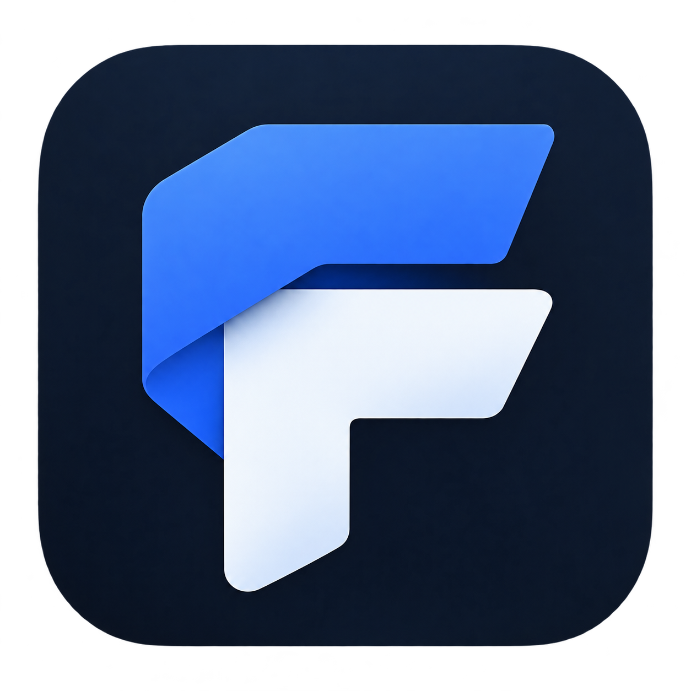

<div align="center">



# Forma

**A Windows desktop studio for presentations and posters.**

Describe the result → add context → generate → refine → export.

</div>

---

## What is Forma?

Forma turns a rough idea into finished pages. Instead of starting from a blank
slide or canvas, you write a short brief and Forma generates the pages for you,
then lets you refine them through conversation until they look right.

Start a project by picking a format — **slides** or a **poster** — and setting
the basics: slide count and size, or poster type (screen or print) with sizes
from A4 up to tabloid, plus orientation. You can also describe the look you're
going for, and Forma searches the web for images to use.

Everything you make lives in a single project folder you can copy, move, or
back up like any other document, and the library keeps your recent projects a
click away.

## How it works

1. **Describe** what you want — a story told slide by slide, or one poster composition with a clear message.
2. **Add context** — import PDFs, documents, images, or paste text; Forma reads it all, including scanned pages, and uses it to shape the content.
3. **Plan** — Forma proposes an outline. Review and edit it before anything is built, or skip planning and generate right away.
4. **Generate** — your pages appear as live previews you can browse in a thumbnail rail.
5. **Refine** — ask for changes in chat: rework a page, adjust the whole design, swap images, or rewrite content until it's right.
6. **Export** — save a PDF or high-resolution PNGs of every page or just the ones you select, ready for the screen or the printer.

## Installing

Download the Windows x64 setup executable from
[GitHub Releases](https://github.com/Vortextbloons/Forma/releases). It installs
per user with everything included — no separate setup required.

See [CHANGELOG.md](CHANGELOG.md) for detailed release notes.

When a newer version is available, click **Update** in **Settings → App & worker**.
Forma verifies the download, installs it silently, and reopens automatically,
saving any in-progress work first.

## Development

```sh
npm install
npm run dev:desktop   # wails3 dev via rig; requires wails3 on PATH
npm run typecheck
npm test
```

For UI-only work, `cd app && npm run dev` runs the app in a browser with a mock
backend.

The Windows release bundles a Python runtime for the built-in web and image
search (`desktop/scripts/release.ps1`, pinned in
`desktop/build/ddgs-requirements.txt`). For development, create the local search
runtime once:

```sh
python -m venv desktop/bin/ddgs
desktop/bin/ddgs/Scripts/python.exe -m pip install -r desktop/build/ddgs-requirements.txt
```

Forma finds this runtime automatically. `FORMA_DDGS_PYTHON` overrides the Python
executable; `FORMA_DDGS_HELPER` overrides the bundled helper script for testing.
